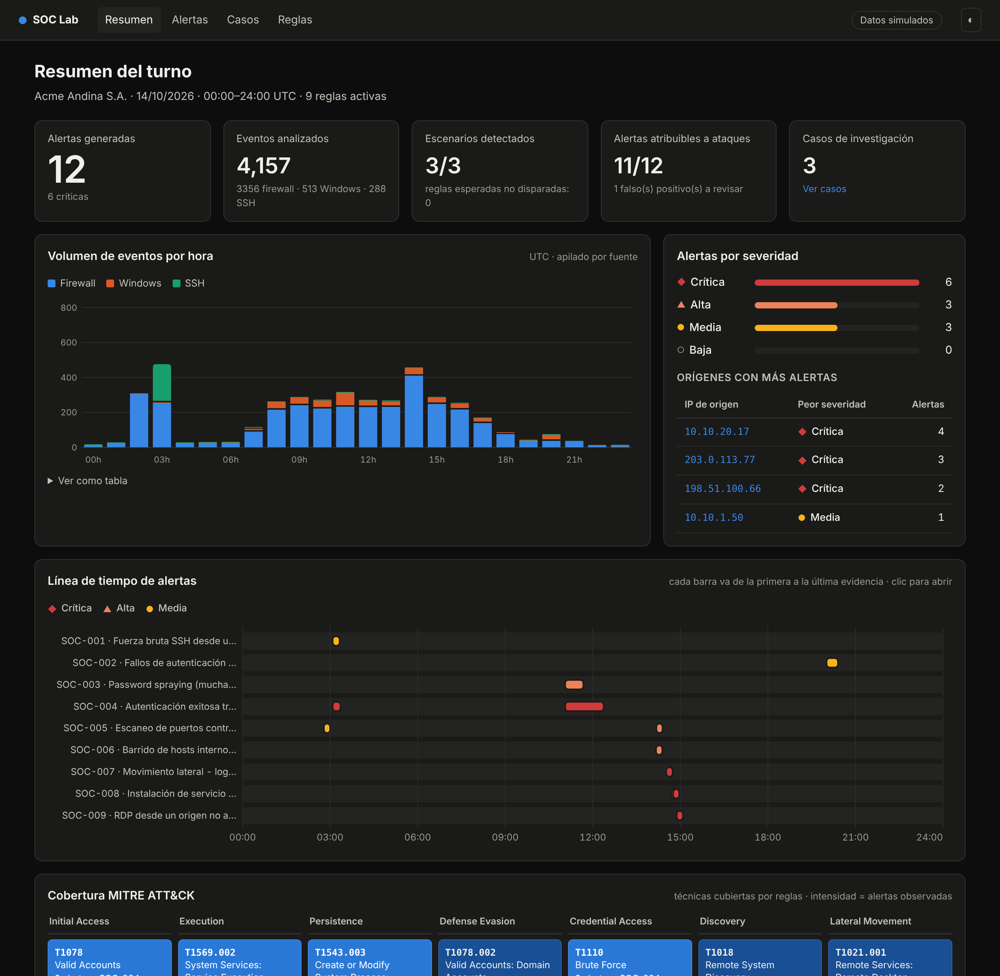
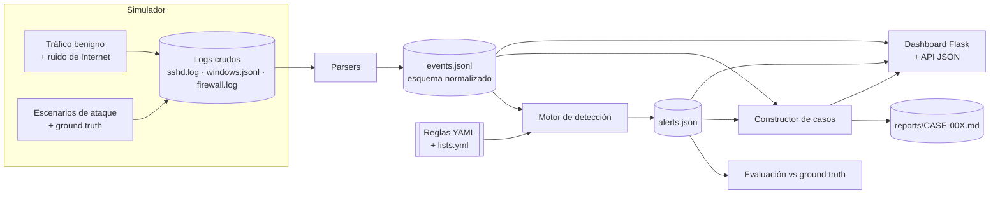
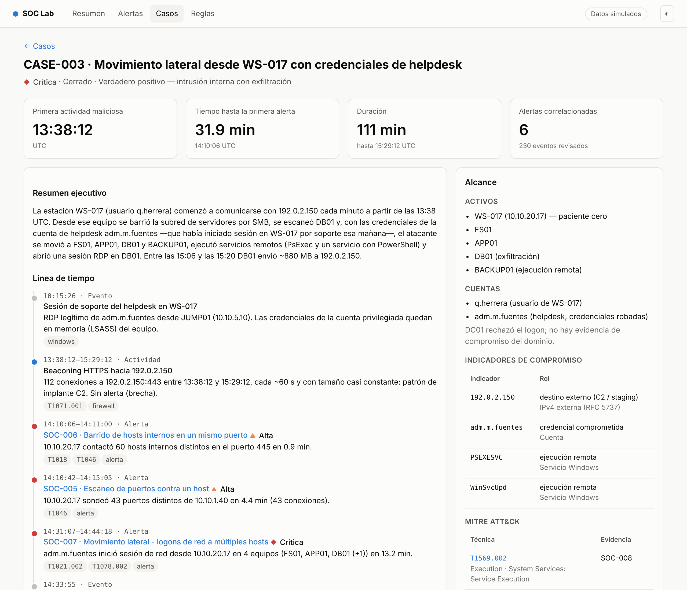

# SOC Lab · Detección y respuesta con datos simulados

[](https://github.com/KevinDGE/LAB_SOC/actions/workflows/ci.yml)


Laboratorio de un Centro de Operaciones de Seguridad (SOC) de punta a punta:
**genera** los logs de un día de trabajo en una organización ficticia, los
**normaliza**, ejecuta **reglas de detección documentadas y mapeadas a MITRE
ATT&CK**, muestra las alertas en un **dashboard web** y documenta **tres
investigaciones** completas con línea de tiempo y reporte de incidente.

> **Datos 100 % simulados.** La organización (Acme Andina S.A.), las personas y
> los equipos son ficticios. Todas las IPs externas pertenecen a los rangos
> reservados para documentación por el [RFC 5737](https://www.rfc-editor.org/rfc/rfc5737)
> (`192.0.2.0/24`, `198.51.100.0/24`, `203.0.113.0/24`), así que ningún dato
> apunta a infraestructura real. Una prueba automática lo verifica.



## Inicio rápido

**Con Docker** (un solo comando):

```bash
docker compose up --build
```

Abre <http://localhost:8000>. El contenedor genera los datos, ejecuta las
detecciones, construye los casos y sirve el dashboard con gunicorn (sistema de
archivos de solo lectura, usuario sin privilegios y healthcheck).

**Sin Docker** (Python 3.10+):

```bash
pip install -r requirements-dev.txt
```

```bash
python -m soc_lab all --serve
```

Pruebas, dentro o fuera del contenedor:

```bash
python -m pytest
```

```bash
docker compose run --rm --build tests
```

## Qué demuestra este proyecto

| Competencia | Dónde verla |
|---|---|
| Conocimiento de telemetría real (sshd, Windows 4624/4625/7045, firewall) | [`soc_lab/simulator/`](soc_lab/simulator), [`soc_lab/parsers/`](soc_lab/parsers) |
| Normalización a un esquema común (inspirado en ECS) | [`soc_lab/schema.py`](soc_lab/schema.py) |
| Ingeniería de detección como código, con umbrales, correlación y allowlists | [`soc_lab/detection/rules/`](soc_lab/detection/rules) |
| Mapeo y cobertura MITRE ATT&CK | [`docs/detection-rules.md`](docs/detection-rules.md) |
| Ajuste de falsos positivos (escáner autorizado, jump host, cuentas de servicio) | [`soc_lab/detection/lists.yml`](soc_lab/detection/lists.yml) |
| Triage e investigación, línea de tiempo, IoCs, contención | [`reports/`](reports) |
| Identificación honesta de brechas de detección | sección 8 de cada reporte |
| Validación de la detección contra *ground truth* | [`soc_lab/detection/evaluate.py`](soc_lab/detection/evaluate.py), [`tests/`](tests) |

## Arquitectura



El pipeline es determinista: con la misma semilla (`--seed`, por defecto 1337)
se obtienen exactamente los mismos logs, alertas y reportes. Por eso los
reportes de [`reports/`](reports) están versionados y la CI comprueba que siguen
sincronizados con el código.

## El escenario

**Acme Andina S.A.** (`corp.local`): 40 empleados con estación propia, 7
servidores (DC, archivos, ERP, SQL, respaldos, correo/OWA y web en DMZ), un
escáner de vulnerabilidades autorizado (SCAN01) y un jump host de
administración (JUMP01). Topología en [`soc_lab/simulator/topology.py`](soc_lab/simulator/topology.py).

El simulador recrea el 14/10/2026 (UTC) con ~4.200 eventos:

| Hora (UTC) | Actividad | Tipo |
|---|---|---|
| todo el día | logons de empleados, recursos compartidos, ERP, navegación, clientes web/OWA | benigno |
| todo el día | bots de Internet con 1–4 intentos SSH o puertos bloqueados | ruido (bajo umbral) |
| 01:00 | respaldo nocturno de `svc_backup` | benigno |
| 02:00 | escaneo autorizado de SCAN01 (CHG-2291) | benigno, **suprimido** por allowlist |
| 02:47–03:31 | **CASE-001** escaneo + fuerza bruta SSH + acceso + descarga | ataque |
| 10:15 | el helpdesk atiende WS-017 por RDP desde JUMP01 | benigno (clave en CASE-003) |
| 11:03–12:22 | **CASE-002** password spraying contra OWA, 2 cuentas comprometidas | ataque |
| 13:38–15:29 | **CASE-003** C2, descubrimiento, movimiento lateral, PsExec, RDP, exfiltración | ataque |
| 20:00 | `svc_backup` con contraseña expirada (36 fallos) | **falso positivo** deliberado |

## Reglas de detección

Nueve reglas declarativas en YAML, cada una con descripción, lógica, mapeo
ATT&CK, falsos positivos conocidos, preguntas de triage, respuesta y
referencias. La documentación completa se genera desde los YAML:
[`docs/detection-rules.md`](docs/detection-rules.md).

| ID | Regla | Técnica ATT&CK | Lógica |
|---|---|---|---|
| SOC-001 | Fuerza bruta SSH | T1110.001 | ≥ 10 fallos por IP y host en 5 min |
| SOC-002 | Fallos repetidos contra una cuenta Windows | T1110.001 | ≥ 10 × 4625 por cuenta y host en 10 min |
| SOC-003 | Password spraying | T1110.003 | ≥ 10 usuarios distintos fallidos por IP en 30 min |
| SOC-004 | Éxito tras múltiples fallos | T1110, T1078 | secuencia: ≥ 10 fallos → éxito, misma IP, 30 min |
| SOC-005 | Escaneo de puertos | T1046 | ≥ 20 puertos distintos por par origen/destino en 5 min (alta si es interno) |
| SOC-006 | Barrido de hosts internos | T1018, T1046 | ≥ 10 IPs internas distintas en el mismo puerto en 10 min |
| SOC-007 | Movimiento lateral por logons de red | T1021.002, T1078.002 | misma cuenta y origen en ≥ 3 hosts (4624 tipo 3) en 30 min |
| SOC-008 | Servicio sospechoso instalado | T1569.002, T1543.003 | 7045 con PsExec, cmd/PowerShell o rutas temporales |
| SOC-009 | RDP desde origen no autorizado | T1021.001 | 4624 tipo 10 cuyo origen no es JUMP01 |

Ejemplo (`SOC-003_password_spraying.yml`, resumido):

```yaml
id: SOC-003
name: Password spraying (muchas cuentas desde un origen)
severity: high
mitre:
  tactics: [Credential Access]
  techniques:
    - {id: T1110.003, name: "Brute Force: Password Spraying", tactic: Credential Access}
logic:
  type: distinct          # threshold | distinct | sequence
  filter: {category: authentication, outcome: failure}
  group_by: [src_ip]
  distinct_field: user
  window: 30m
  threshold: 10
summary: "{src_ip} falló la autenticación contra {distinct_users} cuentas distintas…"
```

El motor ([`engine.py`](soc_lab/detection/engine.py)) soporta ventanas
deslizantes, conteo de valores distintos, secuencias de dos pasos, operadores
(`in`, `cidr`, `contains_any`, `startswith`, `gte`…), listas de referencia
(`$authorized_scanners`), excepciones y ajustes de severidad según contexto
(p. ej. un escaneo **interno** sube a *alta*; tocar DC01/DB01/BACKUP01 sube a
*crítica*). Una ráfaga larga produce **una** alerta, no cientos.

## Resultados

```text
python -m soc_lab detect
[detect] 12 alertas
[evaluate]
  OK  CASE-001  disparadas=['SOC-001', 'SOC-004', 'SOC-005']  faltantes=[]
  OK  CASE-002  disparadas=['SOC-003', 'SOC-004']  faltantes=[]
  OK  CASE-003  disparadas=['SOC-005', 'SOC-006', 'SOC-007', 'SOC-008', 'SOC-009']  faltantes=[]
  alertas atribuidas a escenarios: 11/12  no atribuidas: ['SOC-002-157d3be9']
```

- **3/3 escenarios detectados**, con todas las reglas esperadas.
- **0 alertas** por el escaneo autorizado, la administración desde JUMP01 ni el ruido de Internet.
- **1 falso positivo**, intencional: `svc_backup` con contraseña expirada
  (`SubStatus 0xC0000071`). Se deja visible porque es el tipo de alerta que un
  analista N1 cierra a diario; la regla SOC-002 documenta cómo reconocerlo.

## Casos de investigación

| Caso | Resumen | Alertas | Reporte |
|---|---|---|---|
| CASE-001 | Escaneo y fuerza bruta SSH contra el servidor web; la cuenta `deploy` (con contraseña débil) cae y el servidor descarga herramientas | 3 | [CASE-001.md](reports/CASE-001.md) |
| CASE-002 | Password spraying lento contra OWA (1 cuenta/min); `r.medina` y `e.vega` comprometidas y buzón accedido | 2 | [CASE-002.md](reports/CASE-002.md) |
| CASE-003 | WS-017 con implante C2 → barrido SMB → credenciales de helpdesk robadas → PsExec y RDP en servidores → ~880 MB exfiltrados | 6 | [CASE-003.md](reports/CASE-003.md) |

Cada reporte incluye ficha del incidente, resumen ejecutivo, alcance, línea de
tiempo, análisis técnico con evidencia cruda, mapeo ATT&CK, IoCs, acciones de
contención/erradicación/recuperación y **lecciones aprendidas con las brechas de
detección**. Por ejemplo, en CASE-003 el beaconing y la exfiltración no generan
alertas: el reporte lo marca como brecha y propone las reglas que faltan.



## Dashboard

| Vista | Contenido |
|---|---|
| **Resumen** `/` | indicadores, volumen por hora y fuente, alertas por severidad, orígenes más activos, línea de tiempo por regla, matriz ATT&CK |
| **Alertas** `/alerts` | filtros por severidad, regla, táctica y texto libre (IP, usuario, host) |
| **Detalle de alerta** | entidades, agrupación, guía de triage de la regla y evidencia cruda |
| **Casos** `/cases` | línea de tiempo, análisis, IoCs, ATT&CK y respuesta |
| **Reglas** `/rules` | catálogo con lógica, excepciones y alertas generadas |
| **API** | `/api/stats`, `/api/alerts?severity=&rule=&tactic=&q=`, `/api/alerts/<id>`, `/api/rules`, `/api/cases`, `/healthz` |

Los gráficos son SVG generados en el servidor: sin CDN ni JavaScript de
terceros, con modo claro/oscuro, tooltips accesibles por teclado y vista de
tabla.

## Comandos

| Comando | Qué hace |
|---|---|
| `python -m soc_lab generate [--seed N]` | genera los logs crudos y los normaliza en `data/events.jsonl` |
| `python -m soc_lab detect` | ejecuta las reglas, evalúa contra el ground truth y escribe `data/alerts.json` |
| `python -m soc_lab cases` | construye los casos (`data/cases.json`) y los reportes (`reports/`) |
| `python -m soc_lab docs` | regenera `docs/detection-rules.md` desde los YAML |
| `python -m soc_lab serve [--port 8000]` | levanta el dashboard |
| `python -m soc_lab all [--serve]` | todo lo anterior en orden |

Atajos equivalentes en el [`Makefile`](Makefile): `make run`, `make serve`,
`make test`, `make docker`, `make docker-test`.

## Pruebas

85 pruebas con `pytest` ([`tests/`](tests)):

- **Parsers**: cada formato crudo y los casos borde (líneas no relevantes, campos `-`).
- **Simulador**: determinismo por semilla, todas las IPs internas o RFC 5737, cada línea cruda se parsea.
- **Motor**: umbrales, conteo de distintos, secuencias, ventanas, excepciones, overrides y validación de reglas mal formadas.
- **Reglas reales**: cada regla está documentada y mapeada, cada regla dispara, los 3 escenarios se detectan por completo, la actividad autorizada queda suprimida y el único falso positivo es el esperado.
- **Casos**: líneas de tiempo ordenadas, IoCs, brechas documentadas y reportes versionados sincronizados.
- **Dashboard**: todas las rutas, filtros, 404, API y escape de entradas (XSS).

La CI ([`.github/workflows/ci.yml`](.github/workflows/ci.yml)) ejecuta las
pruebas en Python 3.10 y 3.12, comprueba que docs y reportes estén al día y
valida la imagen Docker con su healthcheck.

## Extender el laboratorio

- **Nueva regla**: crea `soc_lab/detection/rules/SOC-0XX_nombre.yml`, ejecuta
  `python -m soc_lab docs` y añade el escenario o la prueba que la ejercite.
  `test_every_rule_fires_on_dataset` falla si la regla nunca dispara.
- **Nueva fuente**: escribe `parse_line(line) -> Event | None` en
  `soc_lab/parsers/` y regístrala en `PARSERS`; las reglas existentes que filtran
  por `category`/`outcome` (p. ej. SOC-003 y SOC-004) la cubren sin cambios.
- **Nuevo escenario**: añade una función en `soc_lab/simulator/scenarios.py`
  que devuelva su `Scenario` con las reglas esperadas.

Siguientes pasos naturales, identificados en los reportes: beaconing (SOC-011),
volumen saliente anómalo (SOC-012), primera conexión saliente desde la DMZ
(SOC-010) y exportación de las reglas a [Sigma](https://github.com/SigmaHQ/sigma).

## Estructura

```text
soc_lab/
├── schema.py               # Event / Alert normalizados
├── simulator/              # topología, tráfico benigno, escenarios, escritura de logs crudos
├── parsers/                # sshd, Windows (JSON), firewall → Event
├── detection/
│   ├── engine.py           # motor declarativo
│   ├── rules/*.yml         # 9 reglas mapeadas a ATT&CK
│   ├── lists.yml           # allowlists y listas de activos críticos
│   ├── evaluate.py         # cobertura vs ground truth
│   └── docs.py             # genera docs/detection-rules.md
├── cases/                  # definiciones de casos y generador de reportes
├── dashboard/              # Flask, plantillas Jinja, CSS y JS sin dependencias
└── pipeline.py / __main__.py
reports/                    # reportes de incidente (generados y versionados)
docs/                       # documentación de reglas y capturas
tests/                      # pytest
Dockerfile · docker-compose.yml · Makefile
```

## Uso responsable

Proyecto educativo y de portafolio. No contiene herramientas ofensivas ni
datos reales: los "ataques" son líneas de log sintéticas que imitan la huella
que dejaría cada técnica en la telemetría defensiva.
